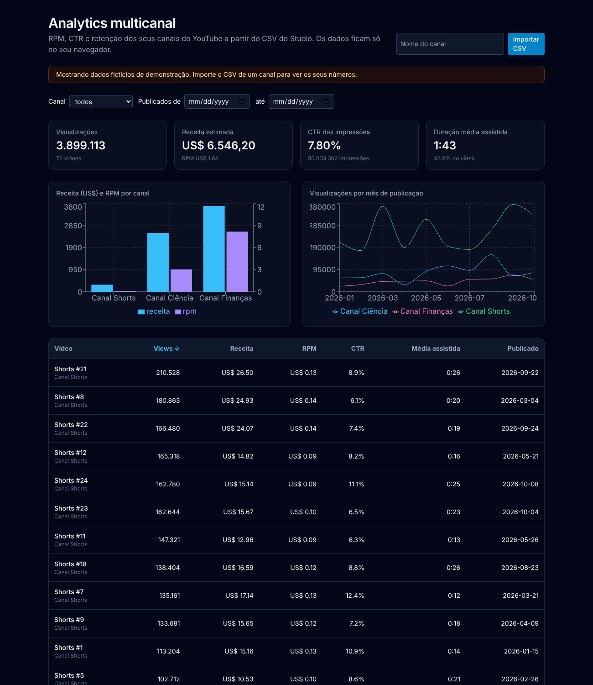

# Multi-Channel Analytics Dashboard

[](https://github.com/SrSatriano/multi-channel-analytics-dashboard/actions/workflows/ci.yml)


Painel para quem tem mais de um canal no YouTube. Você importa o CSV que o YouTube Studio exporta e vê, lado a lado:
- RPM e receita;
- CTR das impressões;
- duração média assistida e % do vídeo;
- visualizações por mês;
- ranking de vídeos.

Os dados ficam só no seu navegador. O site é estático e funciona sem servidor e sem chave de API.



## Como usar com os seus canais

1. No YouTube Studio, abra **Análise**, clique em **Modo avançado**, escolha a aba **Conteúdo**, o período que quiser e **Exportar → CSV**.
2. Abra o ZIP e pegue o arquivo **Dados da tabela.csv** (*Table data.csv*).
3. No painel, digite o nome do canal e clique em **Importar CSV**. Repita para cada canal.

Funcionam as exportações em português e em inglês. A linha "Total" do Studio é ignorada, e reimportar um canal substitui os dados dele.

## O que é calculado

| Métrica | Fórmula |
|---|---|
| RPM | receita estimada ÷ visualizações × 1.000 |
| CTR | ponderado pelas impressões de cada vídeo, não a média simples das taxas |
| Duração média assistida | horas assistidas × 3.600 ÷ visualizações |
| % do vídeo assistido | segundos assistidos ÷ (duração × visualizações), nos vídeos com duração |

Filtros por canal e por período de publicação; o ranking ordena por views, receita, RPM, CTR, média assistida ou data.

## Rodando

```bash
npm install
npm run dev          # http://localhost:3000
npm test             # parser e métricas (vitest)
npm run build        # gera o site estático em out/
```

Para publicar no GitHub Pages, gere com `BASE_PATH=/multi-channel-analytics-dashboard npm run build` e publique a pasta `out/`.

## Estrutura

```
lib/youtube.ts   parser do CSV do Studio (aspas, números pt-BR/en, datas "3 de nov. de 2026" / "Nov 3, 2026")
lib/metrics.ts   totais, por canal, por mês, ranking e filtros
lib/demo.ts      dados fictícios e determinísticos para a demonstração
components/      KPIs, gráficos (Recharts), tabela e importador
tests/           8 testes com exportações reais de exemplo em pt-BR e en (examples/)
```

## Autor

Matheus Rodrigues Satriano — [github.com/SrSatriano](https://github.com/SrSatriano)
